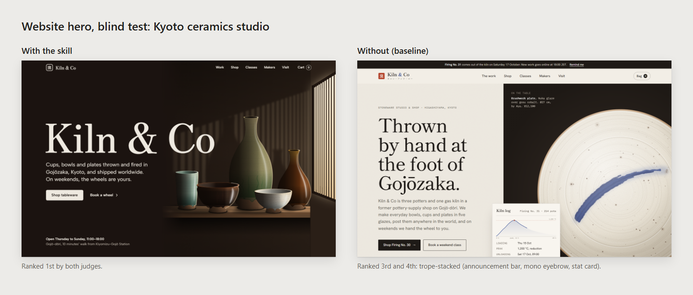
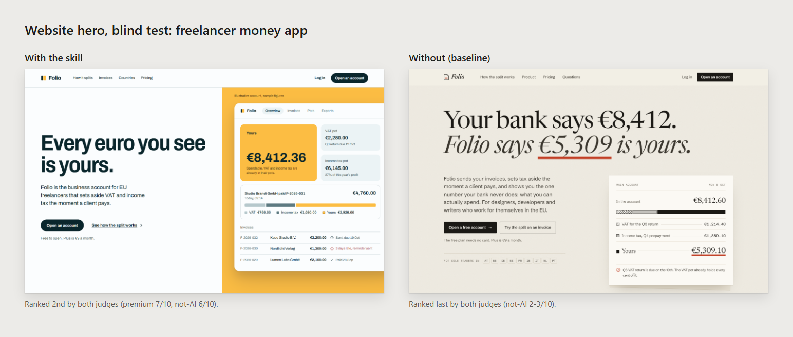
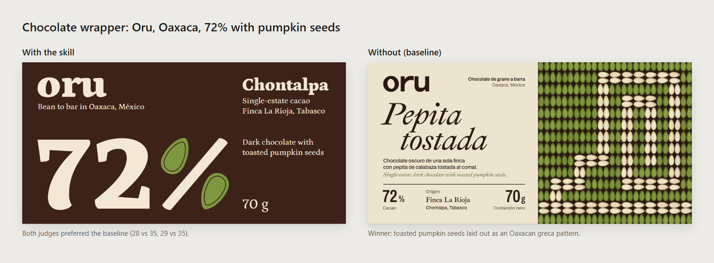

# premium-design

A [Claude Code](https://claude.com/claude-code) skill for building **websites and app interfaces that look premium and modern and do not look AI-generated**.

The rules come from research, not taste. 63 YouTube videos and 49 articles were mined: the top videos on premium and modern design, Apple as a case study, avoiding the "AI look", and design rules. That produced about 2,650 concrete design decisions. Each decision is ranked by **how many independent creators state it**, so advice repeated across many sources outranks one person's opinion. The skill was then blind-tested against Claude with no skill, and rewritten until it won.



## What it does

When you ask Claude Code to build or restyle a website, landing page, app screen, dashboard or component (HTML, CSS, Tailwind, React or SwiftUI), the skill gives it:

- **A presence-first approach.** One confident display moment, the product or subject shown as something worth wanting, type and colour drawn from the brand's own world, and deep real content.
- **Evidence-ranked rules with real numbers** for spacing, type scale, tracking, colour, contrast, motion and components. Each rule is tagged with how many creators back it, e.g. `[16]`.
- **The AI "trope stacks" to avoid**, such as purple gradients, pill eyebrows, icon-card grids and the "AI editorial luxury" kit. For each one it gives a stronger brand-specific move instead of a blander one.
- **Context switches** for marketing pages, product UI, dense dashboards, docs, local venues, luxury brands and native iOS/macOS.
- **Two checkers:**
  - `scripts/slop_check.py` scans HTML/CSS/JSX for code-level AI tells.
  - `scripts/render_check.py` renders the page in headless Chrome or Edge from 320px to 1440px. It fails overflow, illegible text and broken H1s, and saves first-viewport and full-page screenshots.

## Install

The skill is the `premium-design/` folder. Put it in your personal skills folder to use it in every project:

```bash
git clone https://github.com/Woshvad/premium-design-skill.git
mkdir -p ~/.claude/skills && cp -r premium-design-skill/premium-design ~/.claude/skills/
```

On Windows (PowerShell):

```powershell
git clone https://github.com/Woshvad/premium-design-skill.git
New-Item -ItemType Directory -Force "$HOME\.claude\skills" | Out-Null
Copy-Item -Recurse premium-design-skill\premium-design "$HOME\.claude\skills\"
```

To make it available in one project only, copy it to `<project>/.claude/skills/premium-design` instead. Start a new Claude Code session afterwards.

**Requirements:** Python 3.8+ (both scripts use only the standard library) and Google Chrome, Chromium or Microsoft Edge for `render_check.py`.

## Use

- Just ask for UI work, for example *"build a landing page for…"*, *"make this dashboard look more premium"* or *"does this page look AI-generated?"*. Claude loads the skill automatically.
- Or invoke it directly with `/premium-design`.
- You can also run the checkers yourself:

```bash
python premium-design/scripts/slop_check.py --surface marketing path/to/page.html
python premium-design/scripts/render_check.py path/to/page.html --full --out shots/
```

## The most-backed decisions

Ten of the twelve most-backed decisions, with the number of independent creators who state each one. Ranks 10 and 12 are omitted here: one depends on context, the other is about AI workflow. The exact ordering is in the full ranking.

| Decision | Creators |
|---|---|
| Use 2–3× more whitespace than a standard interface, but only next to confident type and a real product | 16 |
| Set spacing by relationship: tight inside a group, at least 2× that between groups, the most between sections | 14 |
| Don't assemble the category's stock section sequence (logo cloud, stat strip, 3 feature cards, 3-tier pricing…) | 14 |
| Never make Inter, Roboto, Arial or a system default the headline voice | 13 |
| Track letter-spacing inversely to size: caps labels looser, display type tighter | 11 |
| Don't default to purple/violet gradients and fills | 11 |
| Animate only when the motion has a job you can state in one sentence | 11 |
| Take every spacing and size value from one token scale | 11 |
| Choose a typeface specific to the brand; audition 3 at hero size | 10 |
| Neutrals for most of the surface, plus exactly one accent colour | 9 |

The full ranking of all 1,064 decisions, plus the Apple playbook, the 44 places where sources disagree with how each is resolved, and the source list, is in [`research/RANKED-DECISIONS.md`](research/RANKED-DECISIONS.md).

## How it was tested

The skill was judged the way it asks you to judge pages: built, rendered and compared blind against Claude with no skill. Judges did not know which version used the skill.

**Round 1.** The first version was a 9,800-word rulebook. It **lost all three briefs**. Its pages were cleaner and less AI-looking, but less premium, because the builder optimised for compliance instead of ambition.

**Round 2.** Four briefs and two judges each ranked four versions blind: no skill, the revised rulebook, a lean presence-first rewrite, and a two-pass variant. Averages over 8 judgements:

| Build | Mean rank (1 = best) | Premium | Not AI-looking | Craft |
|---|---|---|---|---|
| No skill | 3.25 | 6.75 | 3.50 | 5.38 |
| Revised rulebook | 2.38 | 6.88 | 6.75 | 6.88 |
| **Lean presence-first (this skill)** | **2.13** | 6.88 | 6.63 | 6.88 |
| Two-pass | 2.25 | 6.88 | 6.38 | 7.00 |

The lean version shipped, with the two-pass variant's best rule grafted in.



**Caveats.** The judges were models too, and the sample is small: 7 web briefs and 11 judgements. The round 2 rubric named the AI trope stacks explicitly, which favours any build that avoids them. Treat the numbers as directional.

## Not for graphic design

A graphic-design mode was researched separately: 36 more videos and 35 articles on posters, grids, packaging, branding, social and print. It was built and tested in three blind rounds against Claude with no skill. **The skill versions won only 3 of 24 judge votes.** Without guidance, Claude found better concepts from the brief's own facts, such as a venue's floor plan or a calendar of every market Saturday. The rule-guided versions reached for the category's stock image or over-rendered objects.

So the skill excludes posters, packaging, social and print graphics. The graphic-design research is still included as a reference for critique, not as a recipe: [`research/RANKED-GRAPHIC-DECISIONS.md`](research/RANKED-GRAPHIC-DECISIONS.md).



## Repository contents

```
premium-design/                 the skill (copy this folder into ~/.claude/skills/)
  SKILL.md                      entry point: workflow, ranked rules, trope stacks, context switches, checklist
  references/                   typography, colour, layout, components, motion, imagery/copy, Apple playbook, AI tells, evidence
  scripts/slop_check.py         static checker for AI tells in HTML/CSS/JSX/TSX/Vue/Svelte
  scripts/render_check.py       headless-browser render checks and screenshots
  scripts/fixtures/             clean and sloppy example pages for the checkers
research/
  RANKED-DECISIONS.md           full web/UI ranking, Apple playbook, conflict resolutions, sources
  RANKED-GRAPHIC-DECISIONS.md   graphic-design ranking (reference only; see above)
docs/images/                    blind-test comparisons
```

## Sources and credits

Every rule traces back to its sources. [`premium-design/references/evidence.md`](premium-design/references/evidence.md) lists the top decisions with the creators who back them and a full source index linking every video and article. Guidance is paraphrased, with short attributed quotes at most. All credit for the underlying ideas goes to those designers, writers and educators. The research transcripts and video frames used for analysis are not redistributed here.

## License

[MIT](LICENSE)
